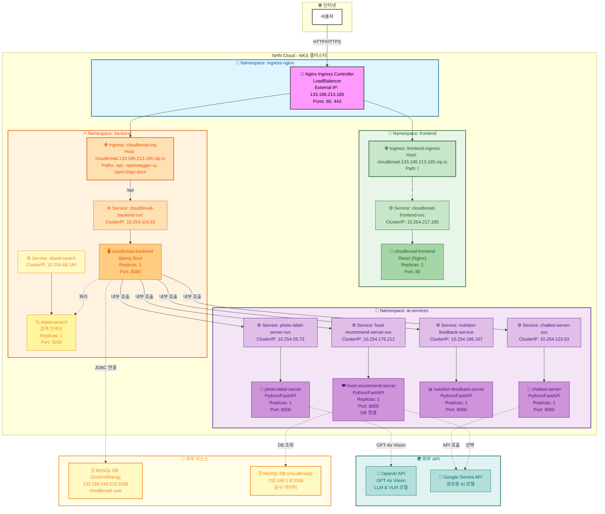

# NKS 클러스터 아키텍처

> 현재 배포된 NHN Cloud NKS(Kubernetes) 클러스터의 실제 구성도

## 아키텍처 다이어그램



## 클러스터 구성 요소

### 1. Ingress Layer (ingress-nginx 네임스페이스)

| 리소스 | 타입 | 상세 정보 |
|--------|------|-----------|
| Nginx Ingress Controller | LoadBalancer | External IP: `133.186.213.185`<br/>Ports: 80 (HTTP), 443 (HTTPS) |

**역할**: 외부 트래픽을 받아 도메인/경로 기반으로 내부 서비스로 라우팅

---

### 2. Frontend Namespace

| 항목 | 값 |
|------|-----|
| Deployment | cloudbread-frontend |
| Replicas | 1 |
| Container Port | 80 |
| Service | cloudbread-frontend-svc (ClusterIP) |
| Cluster IP | 10.254.217.185 |
| Ingress | frontend-ingress |
| 접근 경로 | `/` |
| 기술 스택 | React Native (Expo Web) + Nginx |

**기능**: CloudBread 웹 프론트엔드 (정적 파일 서빙)

**특징**:
- Expo로 빌드된 React 앱
- Nginx로 정적 파일 서빙
- SPA 라우팅 지원 (fallback to index.html)
- 브라우저에서 직접 API 호출
- 프록시 바디 사이즈: 10MB

---

### 3. Backend Namespace

#### 3.1 CloudBread 백엔드 (Spring Boot)

| 항목 | 값 |
|------|-----|
| Deployment | cloudbread-backend |
| Replicas | 1 |
| Container Port | 8080 |
| Service | cloudbread-backend-svc (ClusterIP) |
| Service Port | 80 (Target: 8080) |
| Cluster IP | 10.254.116.65 |
| Ingress | backend-ingress (cloudbread-ing) |
| 접근 경로 | `/api`, `/api/swagger-ui`, `/api/v3/api-docs` |
| DB 연결 | MySQL (133.186.240.215:3306) |
| DB 이름 | GoormBbang |

**기능**: 메인 백엔드 API 서버, 사용자 인증, OAuth2, JWT 토큰 관리

**특징**:
- CORS 활성화 (Origin: http://cloudbread.133.186.213.185.nip.io)
- 프록시 바디 사이즈: 50MB
- 타임아웃: Connect 120s, Read/Send 3600s
- Swagger UI 외부 접근 가능
- MySQL DB 연동 (메인 비즈니스 로직 데이터)
- Elasticsearch 통합 (음식 검색 인덱싱)
- 환경 변수: `app-env` Secret에서 관리 (DB 사용자명, 비밀번호, OAuth 설정 등)

#### 3.2 Elasticsearch (검색 및 인덱싱)

| 항목 | 값 |
|------|-----|
| Deployment | elasticsearch |
| Replicas | 1 |
| Container Port | 9200 |
| Service | elasticsearch (ClusterIP) |
| Service Port | 9200 |
| Cluster IP | 10.254.68.184 |
| Pod IP | 10.100.175.110 |

**기능**: 음식 검색, 영양소 정보 인덱싱, 빠른 조회

**특징**:
- 클러스터 내부 전용 (Backend에서만 호출)
- Food DB 인덱싱 (es-create-foods-index Job으로 초기화)
- 풀텍스트 검색 지원
- 기본 쿼리 포트: 9200

---

### 4. AI Services Namespace

#### 4.1 음식 추천 서버 (Python/FastAPI)

| 항목 | 값 |
|------|-----|
| Deployment | food-recommend-server |
| Replicas | 1 |
| Container Port | 8000 |
| Service | food-recommend-server-svc (ClusterIP) |
| Service Port | 80 (Target: 8000) |
| Cluster IP | 10.254.176.212 |
| Ingress | ai-services-ingress (선택) |
| 접근 경로 | `/api/food` (외부 접근 가능) |
| API Docs | `/api/food/docs` |
| DB 연결 | MySQL (192.168.1.8:3306) |

**기능**: DB 기반 규칙형 임산부 맞춤 식단 추천 서비스

**특징**:
- CORS 활성화
- 프록시 바디 사이즈: 50MB
- 타임아웃: Connect 120s, Read/Send 3600s
- MySQL DB 연동 (실제 음식 데이터 조회)
- 알레르기, 건강 상태, 식단 선호도 기반 필터링
- 최근 섭취 이력 고려한 다양성 확보
- 끼니별 균형잡힌 칼로리 구성 (아침 500kcal, 점심 600kcal, 저녁 550kcal)
- **Backend에서도 호출** (클러스터 내부 통신)

#### 4.2 챗봇 서버 (Python/FastAPI)

| 항목 | 값 |
|------|-----|
| Deployment | chatbot-server |
| Replicas | 1 |
| Container Port | 8000 |
| Service | chatbot-server-svc (ClusterIP) |
| Service Port | 80 (Target: 8000) |
| Cluster IP | 10.254.123.63 |
| Ingress | ai-services-ingress (선택) |
| 접근 경로 | `/api/chatbot` (외부 접근 가능) |
| API Docs | `/api/chatbot/docs` |
| 외부 API | Google Gemini API |

**기능**: AI 챗봇 서비스 (생성형 AI 기반)

**특징**:
- CORS 활성화
- 프록시 바디 사이즈: 50MB
- 타임아웃: Connect 120s, Read/Send 3600s
- Google Gemini API 통합 (LLM 기반 챗봇)
- **Backend에서 호출** (클러스터 내부 통신)
- 외부에서도 직접 접근 가능

#### 4.3 영양 피드백 서버 (Python/FastAPI)

| 항목 | 값 |
|------|-----|
| Deployment | nutrition-feedback-server |
| Replicas | 1 |
| Container Port | 8000 |
| Service | nutrition-feedback-service (ClusterIP) |
| Service Port | 8000 |
| Cluster IP | 10.254.186.107 |
| Ingress | - (내부 전용) |
| 내부 DNS | `nutrition-feedback-service.ai-services.svc.cluster.local` |

**기능**: 영양소 분석 및 개인맞춤 피드백 서비스

**특징**:
- 클러스터 내부 전용 (Backend에서만 호출)
- 섭취한 음식의 영양소 분석
- 개인의 영양 목표 대비 분석
- 개선 권고사항 제공

#### 4.4 음식 사진 라벨링 서버 (Python/FastAPI)

| 항목 | 값 |
|------|-----|
| Deployment | photo-label-server |
| Replicas | 1 |
| Container Port | 8000 |
| Service | photo-label-server-svc (ClusterIP) |
| Service Port | 80 (Target: 8000) |
| Cluster IP | 10.254.55.73 |
| Ingress | - (내부 전용) |
| 내부 DNS | `photo-label-server-svc.ai-services.svc.cluster.local` |
| API 엔드포인트 | `/v1/photo-label` |
| 외부 API | OpenAI GPT-4o Vision |

**기능**: VLM(Vision Language Model)을 이용한 음식 이미지 분석 서비스

**특징**:
- OpenAI GPT-4o Vision 모델 사용
- 클러스터 내부 전용 (Backend에서만 호출)
- 이미지 URL을 받아 음식명과 신뢰도 반환
- 분석 결과를 자동으로 Backend API로 전송
- 외부 OpenAI API와 연동

---

### 5. 외부 리소스

#### 5.1 외부 AI API

**Google Gemini API**
- 사용 서비스: chatbot-server, food-recommend-server (선택)
- 용도: LLM 기반 챗봇, 생성형 AI
- 환경 변수: GOOGLE_API_KEY (Secret 관리)

**OpenAI GPT-4o Vision API**
- 사용 서비스: photo-label-server
- 용도: 음식 이미지 분석 (VLM)
- 환경 변수: OPENAI_API_KEY (Secret 관리)
- 기능: 이미지 → 음식 인식 및 메타데이터 추출

#### 5.3 백엔드용 MySQL 데이터베이스 (GoormBbang)

| 항목 | 값 |
|------|-----|
| 호스트 | 133.186.240.215 |
| 포트 | 3306 |
| 데이터베이스 | GoormBbang |
| 사용 서비스 | cloudbread-backend (Spring Boot) |
| 사용자명 | cloudbread |

**기능**: CloudBread 메인 백엔드 비즈니스 로직 데이터 저장소

**특징**:
- NHN Cloud MySQL 인스턴스
- 사용자 정보, 식단 계획, 섭취 이력 등 저장
- JDBC URL: `jdbc:mysql://133.186.240.215:3306/GoormBbang?characterEncoding=utf8&useSSL=false`
- Spring Boot application.yml에서 참조
- 환경 변수: `app-env` Secret으로 관리

#### 5.4 음식 추천용 MySQL 데이터베이스 (cloudbread)

| 항목 | 값 |
|------|-----|
| 호스트 | 192.168.1.8 (내부 IP) |
| 포트 | 3306 |
| 데이터베이스 | cloudbread |
| 사용 서비스 | food-recommend-server (Python/FastAPI) |

**기능**: 음식 추천을 위한 음식 DB 저장소

**특징**:
- NHN Cloud MySQL 인스턴스
- 내부 IP로 클러스터 내부에서만 접근 가능
- 음식 정보, 영양소 정보, 식단 계획 등 저장
- 주요 테이블: foods, nutrients, food_nutrients, meal_plans

---

## 네트워크 구조

### 외부 접근 경로

**단일 도메인을 통한 통합 접근**:
```
사용자 (브라우저)
    ↓
http://cloudbread.133.186.213.185.nip.io
    ↓
Ingress Controller (133.186.213.185)
    ↓
┌─────────────────────────────────────────┐
````

## 네트워크 구조

### 외부 접근 경로

**단일 도메인을 통한 통합 접근**:
```
사용자 (브라우저)
    ↓
http://cloudbread.133.186.213.185.nip.io
    ↓
Ingress Controller (133.186.213.185)
    ↓
┌─────────────────────────────────────────┐
│ 네임스페이스별 Ingress 분리                 │
├─────────────────────────────────────────┤
│ frontend-ingress (frontend NS)          │
│   /                  → Frontend (React) │
│                                          │
│ backend-ingress (backend NS)             │
│   /api               → Backend (Spring) │
│   /api/swagger-ui    → Swagger UI       │
│   /api/v3/api-docs   → API Docs         │
│                                          │
│ ai-services-ingress (ai-services NS)     │
│   /api/food          → Food AI Service  │
│   /api/chatbot       → Chatbot Service  │
└─────────────────────────────────────────┘
```

### 트래픽 흐름

1. **프론트엔드 접속**:
   ```
   사용자 → Ingress → Frontend Service → Nginx Pod → React 앱 전달
   브라우저에서 React 실행
   ```

2. **API 호출 (브라우저에서)**:
   ```
   React (브라우저) → Ingress → Backend/AI Services
   CORS 문제 없음 (동일 도메인)
   ```

3. **서버 간 통신**:
   ```
   Backend ↔ AI Services: ClusterIP로 내부 통신
   ```

### 내부 통신

- **Backend → AI Services**: ClusterIP 기반 서비스 디스커버리
- **Backend → Elasticsearch**: 클러스터 내부 통신 (음식 검색 인덱싱)
  - Elasticsearch ClusterIP: `10.254.68.184:9200`
  - Spring Data Elasticsearch 라이브러리 사용
- **크로스 네임스페이스 통신**: 
  - `food-recommend-server-svc.ai-services.svc.cluster.local`
  - `chatbot-server-svc.ai-services.svc.cluster.local`
  - `nutrition-feedback-service.ai-services.svc.cluster.local`
  - `photo-label-server-svc.ai-services.svc.cluster.local`
  - `cloudbread-frontend-svc.frontend.svc.cluster.local`
  - `elasticsearch.backend.svc.cluster.local`
- **DB 연결**:
  - **Backend** → MySQL (133.186.240.215:3306/GoormBbang) - JDBC 연결
    - 사용자명: cloudbread
    - 환경 변수: `app-env` Secret에서 관리
  - **Food Recommend Server** → MySQL (192.168.1.8:3306/cloudbread) - pymysql 라이브러리
    - 환경 변수로 연결 정보 관리
- **모든 서비스 ClusterIP**: 외부 직접 접근 차단 (보안)
- **서비스 포트 매핑**: 모든 서비스가 외부 80번 포트로 통일 (내부 컨테이너 포트로 매핑)

---

## 네임스페이스 구조

| Namespace | 용도 | 리소스 |
|-----------|------|--------|
```
| `ingress-nginx` | Ingress 컨트롤러 | Nginx Ingress Controller |
| `frontend` | 웹 프론트엔드 | cloudbread-frontend (React) |
| `backend` | 메인 백엔드 서비스 | cloudbread-backend (Spring Boot), elasticsearch (검색 인덱싱) |
| `ai-services` | AI/ML 서비스 | food-recommend-server, chatbot-server, nutrition-feedback-server, photo-label-server |
| `default` | 기본 네임스페이스 | - |
| `kube-system` | K8s 시스템 | K8s 핵심 컴포넌트 |
| `kube-node-lease` | 노드 리스 | Kubernetes 노드 하트비트 |
| `kube-public` | 공개 리소스 | 클러스터 정보 |
| `local-path-storage` | 저장소 | 로컬 패스 저장소 프로비저너 |

**설계 원칙**:
- 프론트엔드, 백엔드, AI 서비스 완전 분리
- 각 네임스페이스별 독립적인 리소스 관리 및 스케일링
- 단일 Ingress를 통한 통합 라우팅

---

## High Availability (HA) 구성

| 서비스 | Replicas | HA 구성 | 네임스페이스 | 상태 |
|--------|----------|---------|------------|-----|
| cloudbread-frontend | 1 | ⚠️ Single Point | frontend | ✅ Running |
| cloudbread-backend | 1 | ⚠️ Single Point | backend | ✅ Running |
| elasticsearch | 1 | ⚠️ Single Point | backend | ✅ Running |
| food-recommend-server | 1 | ⚠️ Single Point | ai-services | ✅ Running |
| chatbot-server | 1 | ⚠️ Single Point | ai-services | ✅ Running |
| nutrition-feedback-server | 1 | ⚠️ Single Point | ai-services | ✅ Running |
| photo-label-server | 1 | ⚠️ Single Point | ai-services | ✅ Running |

**참고**: 현재는 개발/테스트 환경으로 모든 서비스가 1 replica로 구성

---

## 리소스 할당

### Frontend 리소스
- Requests: CPU 100m, Memory 128Mi
- Limits: CPU 200m, Memory 256Mi

### Backend 리소스
- Requests: CPU 250m, Memory 512Mi
- Limits: CPU 500m, Memory 1Gi

### AI Services 리소스
- **Food Recommend Server**:
  - Requests: CPU 250m, Memory 512Mi
  - Limits: CPU 500m, Memory 1Gi
- **Chatbot Server**:
  - Requests: CPU 250m, Memory 512Mi
  - Limits: CPU 500m, Memory 1Gi
- **Photo Label Server**:
  - Requests: CPU 250m, Memory 512Mi
  - Limits: CPU 500m, Memory 1Gi

---

## 서비스 타입

| 서비스 | 타입 | 포트 매핑 | Cluster IP | 특징 |
|--------|------|----------|-----------|------|
| cloudbread-frontend-svc | ClusterIP | 80→80 | 10.254.217.185 | 내부 전용 |
| cloudbread-backend-svc | ClusterIP | 80→8080 | 10.254.116.65 | 내부 전용 |
| elasticsearch | ClusterIP | 9200→9200 | 10.254.68.184 | 내부 전용 (Backend 전용) |
| food-recommend-server-svc | ClusterIP | 80→8000 | 10.254.176.212 | 내부 전용 |
| chatbot-server-svc | ClusterIP | 80→8000 | 10.254.123.63 | 내부 전용 |
| nutrition-feedback-service | ClusterIP | 8000→8000 | 10.254.186.107 | 내부 전용 (Backend 전용) |
| photo-label-server-svc | ClusterIP | 80→8000 | 10.254.55.73 | 내부 전용 (Backend 전용) |
| ingress-nginx-controller | LoadBalancer | 80, 443 | 10.254.30.76 | 외부 노출 |

**보안**: 모든 애플리케이션 서비스는 ClusterIP로 내부 전용, Ingress를 통해서만 외부 접근 가능

---

## 외부 엔드포인트

| 경로 | 대상 서비스 | Ingress | 설명 |
|------|-----------|---------|------|
| `http://cloudbread.133.186.213.185.nip.io/` | Frontend (React) | frontend-ingress | 웹 애플리케이션 |
| `http://cloudbread.133.186.213.185.nip.io/api` | Backend (Spring Boot) | cloudbread-ing | 메인 API |
| `http://cloudbread.133.186.213.185.nip.io/api/swagger-ui` | Backend Swagger UI | cloudbread-ing | Swagger UI |
| `http://cloudbread.133.186.213.185.nip.io/api/v3/api-docs` | Backend API Docs | cloudbread-ing | OpenAPI 문서 |
| `http://cloudbread.133.186.213.185.nip.io/api/food` | Food Recommend AI | ai-services-ingress | 음식 추천 API |
| `http://cloudbread.133.186.213.185.nip.io/api/food/docs` | FastAPI Docs | ai-services-ingress | 음식 추천 API 문서 |
| `http://cloudbread.133.186.213.185.nip.io/api/chatbot` | Chatbot AI | ai-services-ingress | 챗봇 API |
| `http://cloudbread.133.186.213.185.nip.io/api/chatbot/docs` | FastAPI Docs | ai-services-ingress | 챗봇 API 문서 |

**특징**: 
- 단일 도메인, 경로 기반 라우팅으로 모든 서비스 통합 관리
- 네임스페이스별 Ingress 분리로 독립적 관리
- CORS 문제 없음 (동일 도메인)
- API 문서 외부 접근 가능

---

## 배포 구조

### Frontend (React)
```
빌드: npm run build:web → dist/
Docker: Multi-stage build (Node.js builder + Nginx)
서빙: Nginx (정적 파일)
실행: 사용자 브라우저에서 React 앱 실행
```

### Backend (Spring Boot)
```
빌드: Gradle/Maven
Docker: JDK + Spring Boot JAR
서빙: Embedded Tomcat
```

### AI Services (FastAPI)
```
빌드: Python + requirements.txt
Docker: Python + FastAPI
서빙: Uvicorn ASGI Server
DB: MySQL (food-recommend-server만 사용)
```

**Food Recommend Server 환경 변수**:
- `DB_HOST`: MySQL 호스트 (192.168.1.8)
- `DB_PORT`: MySQL 포트 (3306)
- `DB_NAME`: 데이터베이스명 (cloudbread)
- `DB_USER`: DB 사용자
- `DB_PASSWORD`: DB 비밀번호

---

## 아키텍처 개선 사항

### ✅ 적용된 개선

1. **Full-Stack 배포 완성**
   - Frontend (React) + Backend (Spring Boot) + AI Services (FastAPI)
   - 단일 도메인으로 모든 서비스 통합

2. **네임스페이스 역할 분리**
   - Frontend: 웹 UI
   - Backend: 비즈니스 로직
   - AI Services: AI/ML 서비스
   - 독립적인 관리 및 스케일링 가능

3. **Ingress 네임스페이스별 분리**
   - 각 네임스페이스마다 독립적인 Ingress 관리
   - frontend-ingress, backend-ingress, ai-services-ingress
   - 경로 기반 라우팅으로 명확한 구분
   - API 문서 외부 접근 가능

4. **서비스 타입 통일**
   - 모든 서비스 ClusterIP 사용
   - 서비스 포트 80으로 통일 (내부 컨테이너 포트 매핑)
   - 보안 강화

5. **리소스 할당 정책**
   - 모든 서비스에 리소스 Requests/Limits 설정
   - Frontend: 가벼운 리소스 (100m/200m CPU)
   - Backend & AI Services: 중간 리소스 (250m/500m CPU)

6. **CORS 및 프록시 설정**
   - Backend 및 AI Services에 CORS 활성화
   - 프록시 타임아웃 확장 (최대 1시간)
   - 대용량 파일 업로드 지원 (최대 50MB)

---

## 확인 명령어

```bash
# 네임스페이스 확인
kubectl get namespaces

# 각 네임스페이스별 리소스 확인
kubectl get all -n frontend
kubectl get all -n backend
kubectl get all -n ai-services
kubectl get all -n ingress-nginx

# Ingress 확인
kubectl get ingress -A

# 서비스 확인
kubectl get svc -A

# 전체 Pod 상태 확인
kubectl get pods -A | grep -E "frontend|backend|ai-services"

# Pod 상세 정보 (IP 포함)
kubectl get pods -n frontend -o wide
kubectl get pods -n backend -o wide
kubectl get pods -n ai-services -o wide

# 클러스터 리소스 요약
kubectl cluster-info
kubectl get nodes

# 배포 상태 확인
kubectl describe deployment cloudbread-backend -n backend
kubectl describe deployment elasticsearch -n backend
kubectl describe deployment -n ai-services

# 배포 테스트
curl http://cloudbread.133.186.213.185.nip.io/
curl http://cloudbread.133.186.213.185.nip.io/api/food/docs
curl http://cloudbread.133.186.213.185.nip.io/api/chatbot/docs
```

---

## 배포 파일 구조

### 분리형 Ingress 아키텍처
각 서비스는 자신의 Ingress 설정을 독립적으로 관리하며, Kubernetes Ingress Controller가 자동으로 병합하여 처리합니다.

### Frontend
- **배포**: `CloudBread_client/deployment.yaml`
- **Ingress**: `CloudBread_client/ingress.yaml`
  - 경로: `/`
  - 독립적으로 배포 가능

### Backend
- **배포**: `CloudBread_server/k8s/deployment.yaml`
- **Ingress**: `CloudBread_server/k8s/ingress.yaml`
  - 경로: `/api`, `/api/swagger-ui`, `/api/v3/api-docs`
  - 독립적으로 배포 가능
- **Legacy**: `CloudBread_server/k8s/legacy/` (참고용 보관)

### AI Services
- **Food Recommend**: `CloudBread/food_recommend/deployment.yaml`
- **Chatbot**: `CloudBread/chatbot/deployment.yaml`
- **Nutrition Feedback**: `CloudBread/nutrition_feedback/deployment.yaml`
- **Photo Label**: `CloudBread/photo_label/deployment.yaml`
- **Ingress**: `CloudBread/ai-services-ingress.yaml` (통합)
  - 경로: `/api/food`, `/api/chatbot`
  - Food Recommend와 Chatbot이 하나의 Ingress 공유
  - Nutrition Feedback과 Photo Label은 내부 전용 (Backend에서만 접근)
- **문서**: `CloudBread/AI_SERVICES_README.md`

### 장점
- ✅ 각 서비스가 자신의 Ingress 파일 관리
- ✅ 독립적 배포/롤백 가능
- ✅ 같은 호스트 사용 시 자동 병합
- ✅ 서비스별 CORS, 타임아웃 등 독립 설정

---

## 기술 스택

### Frontend
- React Native (Expo)
- React Navigation
- TailwindCSS (NativeWind)
- Nginx (정적 파일 서빙)

### Backend
- Spring Boot
- OAuth2 / JWT
- JPA / Hibernate

### AI Services
- FastAPI
- LangChain
- OpenAI API
- Google Gemini API
- PyMySQL (DB 연결)

### Infrastructure
- Kubernetes (NHN Cloud NKS)
- Docker (Multi-architecture)
- Nginx Ingress Controller
- MySQL (NHN Cloud)

### Database
- MySQL 8.0
- NHN Cloud MySQL 인스턴스
- 음식 DB, 영양소 정보, 식단 계획 저장

---

**작성일**: 2025-10-04  
**클러스터**: NHN Cloud NKS  
**상태**: 운영 중  
**최종 업데이트**: 2025-10-22 00:00 KST

### 최근 변경사항 (2025-10-22)
- ✅ **kubectl 기반 실제 클러스터 상태 조회 완료**
  - 모든 Namespace 및 리소스 현황 확인
  - 실제 Pod IP, Cluster IP 정보 업데이트
  - Service 타입 및 포트 매핑 확인
  - Ingress 라우팅 규칙 검증
  - 모든 서비스 정상 Running 상태 확인
- ✅ **Backend MySQL 데이터베이스 연결 명시**
  - 별도의 MySQL DB: 133.186.240.215:3306/GoormBbang
  - Spring Boot JDBC 연결 (app-env Secret 관리)
  - 사용자 정보, 식단 계획, 섭취 이력 저장
  - Elasticsearch 통합 (음식 검색 인덱싱)
- ✅ **Elasticsearch 명시적으로 문서화**
  - Backend Namespace 내 포함
  - Pod IP: 10.100.175.110
  - Food 데이터 인덱싱 Job 완료
  - 검색 기능 지원
- ✅ **이중 MySQL DB 구조 확인**
  - Backend DB: 133.186.240.215:3306/GoormBbang (메인 비즈니스 로직)
  - Food DB: 192.168.1.8:3306/cloudbread (음식 추천 데이터)
- ✅ **AI Services 총 4개 서비스 확인**
  - food-recommend-server (Pod IP: 10.100.175.111)
  - chatbot-server (Pod IP: 10.100.175.112)
  - nutrition-feedback-server (Pod IP: 10.100.175.115) - 11일 운영 중
  - photo-label-server (Pod IP: 10.100.175.116)

### 이전 변경사항 (2025-10-06 19:30)
- ✅ **Food Recommend Server DB 연동 완료**
  - 더미 데이터 → 실제 MySQL DB 기반 추천으로 업그레이드
  - MySQL DB 연결 (192.168.1.8:3306)
  - 실제 음식 데이터 조회 및 개인화 추천 시스템 구현
  - 알레르기, 건강 상태, 식단 선호도, 섭취 이력 기반 필터링
  - 규칙 기반(rule-based) 추천 알고리즘 적용
  - 멀티 아키텍처 재배포 완료 (amd64, arm64)

### 이전 변경사항 (2025-10-06 18:45)
- ✅ **Photo Label Server 배포 완료** (음식 사진 라벨링 AI)
  - VLM(GPT-4o Vision) 기반 음식 이미지 분석
  - 클러스터 내부 전용 서비스 (Backend 전용)
  - 멀티 아키텍처 도커 이미지 (amd64, arm64)
- ✅ AI Services 총 3개 서비스 운영 중
  - food-recommend-server (외부 접근 가능, DB 연동)
  - chatbot-server (외부 접근 가능)
  - photo-label-server (내부 전용)

### 이전 변경사항 (2025-10-04)
- ✅ 분리형 Ingress 아키텍처 구현 (3개의 독립 Ingress)
- ✅ Backend Liveness/Readiness Probe 시간 조정 (90초/60초)
- ✅ 모든 서비스 정상 작동 확인
- ✅ Frontend (React), Backend (Spring Boot), AI Services (FastAPI) 완전 배포
- ✅ 단일 도메인 (`cloudbread.133.186.213.185.nip.io`) 통합 라우팅
- ✅ 문서 및 다이어그램 시인성 개선 (색상 최적화)

---

## 실시간 클러스터 현황 요약 (2025-10-22)

### 전체 클러스터 상태

```
✅ NHN Cloud NKS 클러스터 - 모든 서비스 정상 운영 중
- 총 9개 네임스페이스 활성화
- 총 11개 Pod Running (UI 제외)
- 총 12개 Service 활성화 (시스템 제외)
- Ingress Controller: LoadBalancer (133.186.213.185)
```

### 네임스페이스별 Pod 상태

| Namespace | Pod 수 | 상태 | Replicas |
|-----------|--------|------|----------|
| **frontend** | 1 | ✅ Running | 1/1 |
| **backend** | 2 | ✅ Running | 1/1 (CloudBread) + 1/1 (Elasticsearch) |
| **ai-services** | 4 | ✅ Running | 1/1 x 4 |
| **ingress-nginx** | 1 | ✅ Running | 1/1 |
| **kube-system** | - | - | - |
| **기타** | - | - | - |

### Pod IP 할당 현황

**Frontend**
- `cloudbread-frontend-6674c98fc4-zwk6x`: `10.100.175.108`

**Backend**
- `cloudbread-backend-59dd849c99-rwsg5`: `10.100.175.135` (최근 5시간 이내 재배포)
- `elasticsearch-9764f8b76-29rlt`: `10.100.175.110` (7일 운영 중)

**AI Services**
- `chatbot-server-64854cdf59-dqnhz`: `10.100.175.112`
- `food-recommend-server-b5dc64d-7vj4s`: `10.100.175.111`
- `nutrition-feedback-server-d7bfd66bb-gzprx`: `10.100.175.115` (11일 운영 중)
- `photo-label-server-cf8f7b6f-xwcdg`: `10.100.175.116`

### 서비스 ClusterIP 할당 현황

| 서비스 | ClusterIP | 포트 | 상태 |
|--------|-----------|------|------|
| cloudbread-frontend-svc | 10.254.217.185 | 80 | ✅ Ready |
| cloudbread-backend-svc | 10.254.116.65 | 80→8080 | ✅ Ready |
| elasticsearch | 10.254.68.184 | 9200 | ✅ Ready |
| food-recommend-server-svc | 10.254.176.212 | 80→8000 | ✅ Ready |
| chatbot-server-svc | 10.254.123.63 | 80→8000 | ✅ Ready |
| nutrition-feedback-service | 10.254.186.107 | 8000 | ✅ Ready |
| photo-label-server-svc | 10.254.55.73 | 80→8000 | ✅ Ready |

### Ingress 라우팅 현황

| Ingress | Namespace | 호스트 | 경로 | 백엔드 서비스 | 상태 | 설명 |
|---------|-----------|-------|------|--------------|------|------|
| frontend-ingress | frontend | cloudbread.133.186.213.185.nip.io | `/` | cloudbread-frontend-svc | ✅ Active | 웹 프론트엔드 |
| cloudbread-ing | backend | cloudbread.133.186.213.185.nip.io | `/api*` | cloudbread-backend-svc | ✅ Active | 메인 API |
| ai-services-ingress | ai-services | cloudbread.133.186.213.185.nip.io | `/api/food*`, `/api/chatbot*` | food-recommend-server-svc, chatbot-server-svc | ✅ Active | AI 서비스 (선택, 주로 Backend에서 호출) |

**주의**: AI Services는 Ingress를 통해 외부에서도 직접 접근 가능하지만, **주로 Backend에서 내부 호출**로 사용됨. 모든 AI 서비스는 OpenAI/Gemini API와 연동됨.

### 노드 정보

```
노드: kpaas-contest-2-default-worker-node-0
모든 Pod이 단일 Worker Node에 배포됨
```

### 주요 특징

1. **다중 Ingress 통합**: 3개의 독립적인 Ingress가 단일 도메인으로 병합 관리
2. **네임스페이스 분리**: Frontend, Backend, AI Services 완전 독립
3. **내부 통신**: ClusterIP 기반 클러스터 내부 서비스 디스커버리
4. **검색 기능**: Elasticsearch 통합으로 음식 검색 최적화
5. **AI 서비스 확장**: 4개 AI 서비스 안정적 운영 (nutrition-feedback 추가 포함)
